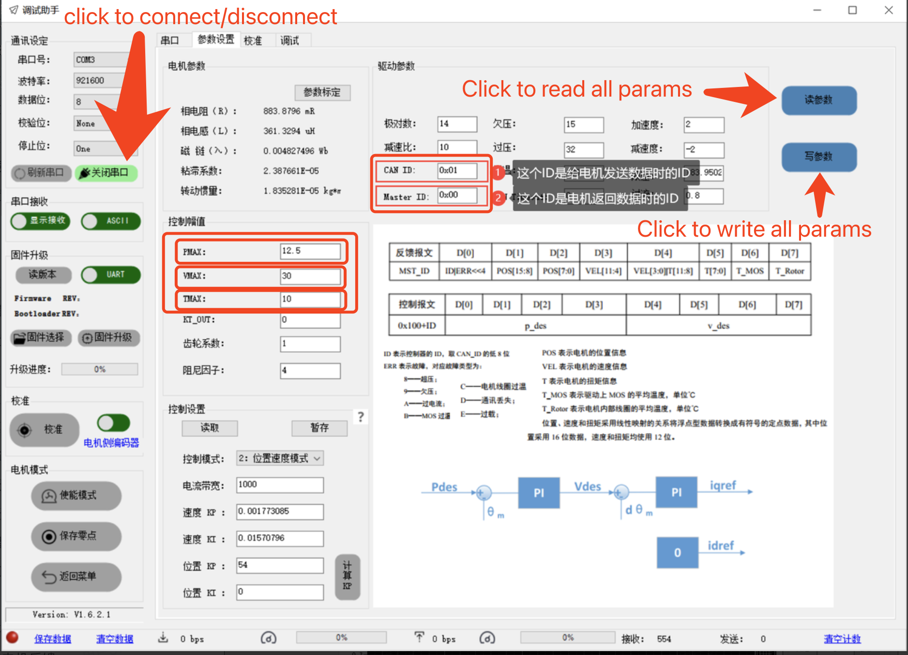

## EtherCAT Task Introduction

### DM Motor

#### Hardware preparation

Connect your motor to any ``CAN`` port of your EtherCAT module.

* **Classic CAN Mode (sdowrite_task_type: 12)**:
  Suitable for standard 1Mbps CAN. Note that a maximum of 3 motors in the same CAN network is suitable for a 1kHz control frequency. If you connect more, please reduce the motor feedback or control frequency.
* **CAN FD Mode (sdowrite_task_type: 16)**:
  Enables FDCAN with BRS (Bit Rate Switch) at 1Mbps nominal arbitration bitrate and 5Mbps data phase bitrate. In this mode, a single CAN network can comfortably support **6 to 8 motors** at a 1kHz control frequency without bus saturation. Ensure your motor is configured to CAN FD mode via DMTools and has a 120 Ohm terminating resistor at the bus end.

> **Note:** all motors will be disabled before receiving any command.

#### Configuration items

* Control Period
    * This controls the frequency at which control frames are sent to the CAN network. For DM Motors, this task will
      forward control commands at this frequency.
* CAN
    * The CAN port you connected to.
* CAN ID
    * The packet ID of the control frame.
* Master ID
    * The packet ID of the feedback frame.
* P Max
    * Max position for data mapping.
* V Max
    * Max velocity for data mapping.
* T Max
    * Max torque for data mapping.
* Control Type
  * The control type of motor.
    * MIT
    * Position Control With Speed Limit, the unit of control target is rad, the unit of speed limitation is rad/s
    * Speed Control, the unit of control target is rad/s

``CAN ID/Master ID`` and ``P/V/T Max`` can be found in the DM Debugging Tool as below.

Please set the PMax to PI using the DMTools software for best ecd accuracy.



More information about DM Motor can be found [here](https://gl1po2nscb.feishu.cn/wiki/MZ32w0qnnizTpOkNvAZcJ9SlnXb).

You can change the publisher topic name by inputting a new name in the ``Motor Feedback Publisher Topic Name`` input
box.

You can change the subscriber topic name by inputting a new name in the ``Motor Command Subscriber Topic Name`` input
box.

#### Related ROS2 Message Types

```c
/* Message type: custom_msgs/msg/ReadDmMotor */

std_msgs/Header header
uint8 online // 0 or 1

uint8 disabled              // 0 or 1
uint8 enabled               // 0 or 1
uint8 overvoltage           // 0 or 1
uint8 undervoltage          // 0 or 1
uint8 overcurrent           // 0 or 1
uint8 mos_overtemperature   // 0 or 1
uint8 rotor_overtemperature // 0 or 1
uint8 communication_lost    // 0 or 1
uint8 overload              // 0 or 1

float32 position    // rad
float32 velocity    // rad/s
float32 torque      // N·m
uint8 mos_temperature
uint8 rotor_temperature
```

```c
/* Message type: custom_msgs/msg/WriteDmMotorMITControl */

uint8 enable    // 0 or 1

float32 p_des
float32 v_des
float32 kp
float32 kd
float32 torque
```

```c
/* Message type: custom_msgs/msg/WriteDmMotorPositionControl */

uint8 enable        // 0 or 1

float32 position    // rad
float32 speed       // rad/s
```

```c
/* Message type: custom_msgs/msg/WriteDmMotorSpeedControl */

uint8 enable        // 0 or 1

float32 speed       // rad/s
```
